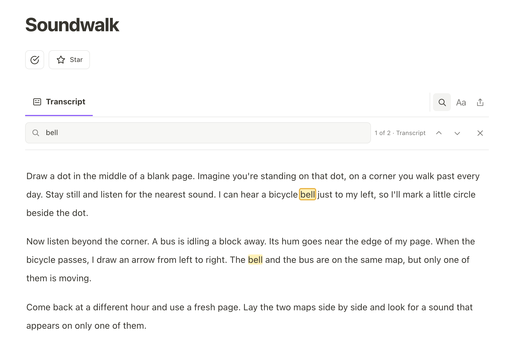

<h1 align="center">LinkRead</h1>

Turn videos and podcast episodes into articles you can search, quote, and read offline on your Mac.

<strong>English</strong> · <a href="README_CN.md">简体中文</a>

<a href="https://github.com/LjyYano/link-read/releases/latest/download/LinkRead-macos-arm64.dmg"><strong>Download for Mac (Apple Silicon)</strong></a> · <a href="https://github.com/LjyYano/link-read/releases/latest">Release notes</a>

## Why LinkRead?

- **Find the part worth reading.** Skim the summary of a long interview, then click a chapter to jump to the speaker’s words. The mind map lets you explore how the topics fit together.
- **Quote a speaker in context.** Press **⌘F** to find a phrase in the transcript or the publisher’s show notes. In **Highlights**, choose **Copy with source** to keep a quote with its timestamp and, for online sources, a link back to the episode or video.
- **Pick up where you stopped.** Your library remembers your place. Choose **Continue reading** on Home to return to the same passage, or press **⌘K** to find another article by title or author.
- **Keep a copy.** Export a single HTML file to read offline in a browser, or save a Markdown version for your notes. You can include the timestamped transcript when you want it.

## Make your first article

1. **Install the app.** On a Mac with an M-series chip, open the downloaded DMG, drag LinkRead into Applications, and launch it.
2. **Connect your AI provider.** Open **Settings → AI generation**. For **Custom API**, enter your provider’s OpenAI-compatible API base URL, model ID, and API key. You can also use a signed-in Codex CLI or Claude Code configured with an Anthropic API key. Choose **Save settings**.
3. **Add something to read.** On Home, paste a YouTube or Bilibili video link, or the share link to an individual Apple Podcasts episode. You can also drop in a subtitle file (SRT, VTT, or subtitle JSON from LinkRead or Bilibili). Choose **Generate article**.
4. **Start reading.** Once generation finishes, the finished article appears in your library. For future articles, **Settings → Language → Generated page language** lets you keep the subtitle language or choose English or Simplified Chinese.

**Try it with a 35-second example.** Open the sample on GitHub and choose **Download raw file**. Drag it into Home and choose **Generate article**. In the original transcript, press **⌘F** and search for `bell` to find both mentions of the bicycle bell. [Soundwalk.vtt](docs/examples/Soundwalk.vtt)

## Common questions

**What if a link has no subtitles?** Choose **Check source** to see whether public subtitles are available. You can import your own file or, for eligible public audio, enable **Settings → Transcribe when subtitles are unavailable**. This optional service is off by default. It uses Alibaba Cloud Model Studio for personal testing, keeps temporary audio uploads for about 48 hours, and may incur charges.

**Can I read offline?** Yes. Your library stays on your Mac, and you can read and export saved articles offline. If you use a cloud AI provider to generate an article, it receives the subtitle text and may charge for processing it.

**How do I update?** LinkRead checks for a new version at launch. You can also choose **LinkRead → Check for Updates…** from the Mac menu bar.

---

[Feedback](https://github.com/LjyYano/link-read/issues) · [Developer guide (Chinese)](desktop/README.md#开发) · [Command-line edition](https://github.com/LjyYano/link-read-cli)

LinkRead Desktop is proprietary. [License](LICENSE) · [Project history and licensing](docs/licensing.md) · [Third-party notices](THIRD_PARTY_NOTICES.md)
