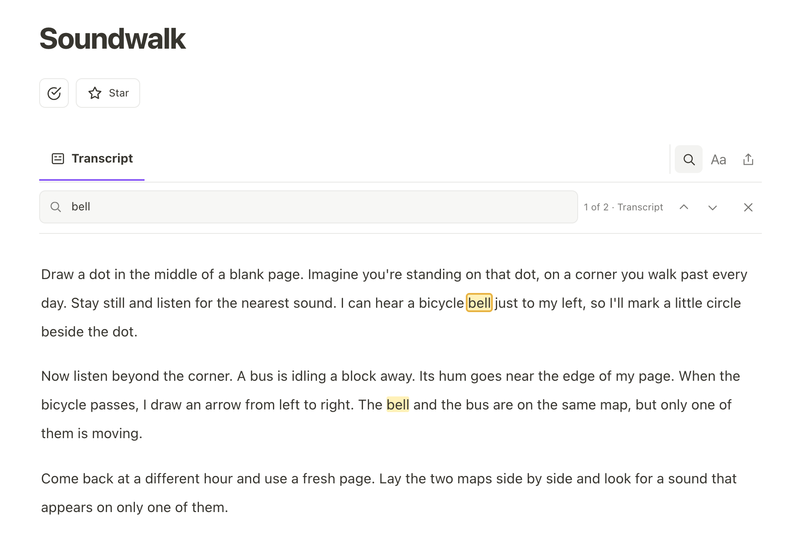

<h1 align="center">LinkRead</h1>

把视频和播客单集变成 Mac 上的文章，随时查找原话、摘录引用，离线也能接着读。

<a href="README.md">English</a> · <strong>简体中文</strong>

<a href="https://github.com/LjyYano/link-read/releases/latest/download/LinkRead-macos-arm64.dmg"><strong>下载 Mac 版（M 系列芯片）</strong></a> · <a href="https://github.com/LjyYano/link-read/releases/latest">更新日志</a>

## 用 LinkRead 可以做什么？

- **挑感兴趣的章节读。** 一期访谈很长，可以先看摘要，再点进某一章读说话人的原话。想理清几个话题之间的关系，可以展开思维导图。
- **引用时保留上下文。** 按 **⌘F** 可以搜索正文和发布者的节目简介。在「摘录」里选择「带出处复制」，就能连同时间戳一起摘下原话。来自视频或播客的摘录还会附上原链接。
- **接着上次的段落读。** 书架会记住阅读位置。点首页的「继续阅读」就能回到上次停下的地方，也可以按 **⌘K**，用标题或作者找回另一篇文章。
- **把文章带走。** 导出为单个 HTML 文件，离线也能用浏览器打开。要整理进自己的笔记，可以导出 Markdown 阅读稿，按需附上带时间戳的逐句字幕。

## 生成第一篇文章

1. **安装应用。** 在搭载 M 系列芯片的 Mac 上打开下载的 DMG，把 LinkRead 拖进「应用程序」，再从那里启动。
2. **配置 AI。** 打开「设置 → AI 生成」。选择「自定义 API」后，填入服务商提供的 OpenAI 兼容 API 地址、模型 ID 和密钥。也可以使用本机已登录的 Codex CLI，或已配置 Anthropic API 密钥的 Claude Code。点「保存设置」。
3. **添加来源。** 在首页粘贴 YouTube、B 站视频链接，或 Apple 播客的单集分享链接。也可以拖入字幕文件，支持 SRT、VTT 以及 LinkRead 或 B 站格式的 JSON。点「生成文章」。
4. **开始阅读。** 字幕就绪后，点「先读原文」就能边读边等 AI 整理。完成版会出现在书架里。如果想用中文读英文节目，可以在生成前打开「设置 → 语言 → 生成网页语言」，选「简体中文」。这里也可以选英文或沿用原字幕语言。

**用 35 秒的示例试一遍。** 打开示例文件，在 GitHub 页面点「Download raw file」下载字幕。把文件拖到首页，点「生成文章」。在英文原文中按 **⌘F** 搜索 `bell`，就能找到两处提到自行车铃的原句。[Soundwalk.vtt](docs/examples/Soundwalk.vtt)

## 常见问题

**链接没有字幕怎么办？** 点「检查来源」可以查看是否有可读取的公开字幕。如果没有，可以导入自己的字幕，也可以在「设置 → 无字幕时转写」里为符合条件的公开音频开启语音识别。转写默认关闭。这个个人测试选项会把音频临时上传到阿里云百炼，远端保留约 48 小时，转写可能产生费用。

**可以离线阅读吗？** 可以。书架保存在你的 Mac 上，已保存的文章可以离线阅读和导出。使用云端 AI 生成文章时，所选服务商会收到字幕文本，并可能按用量收费。

**怎么更新？** LinkRead 启动时会检查新版本，也可以从 Mac 菜单栏选择「LinkRead → 检查更新…」。

---

[问题反馈](https://github.com/LjyYano/link-read/issues) · [开发指南](desktop/README.md#开发) · [命令行版](https://github.com/LjyYano/link-read-cli)

LinkRead 桌面版采用专有许可。[许可条款](LICENSE) · [项目来源与授权说明](docs/licensing.md) · [第三方声明](THIRD_PARTY_NOTICES.md)
